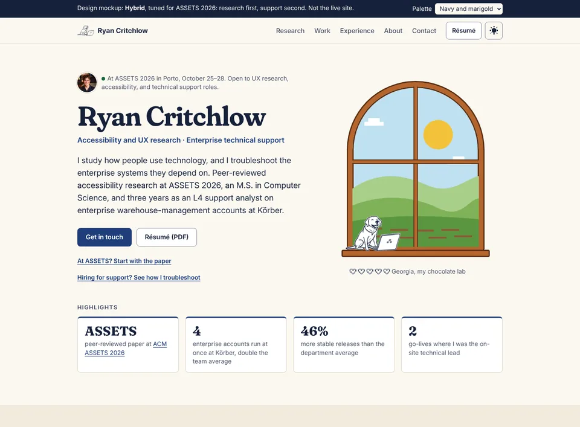
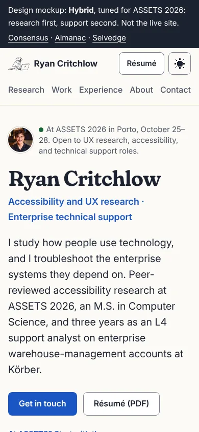
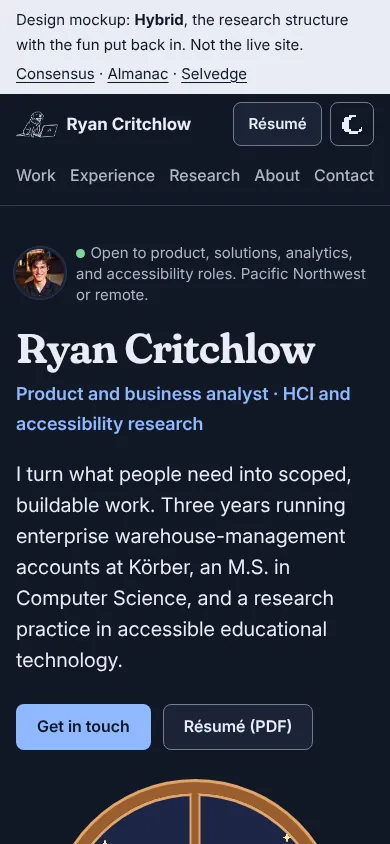
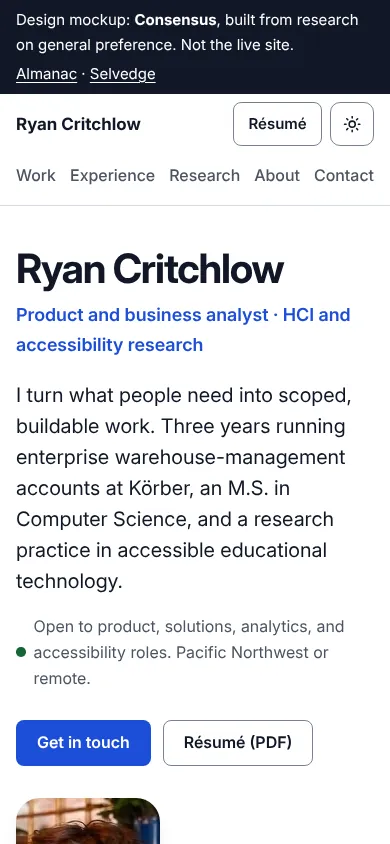
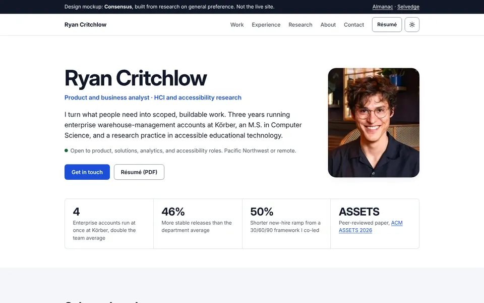
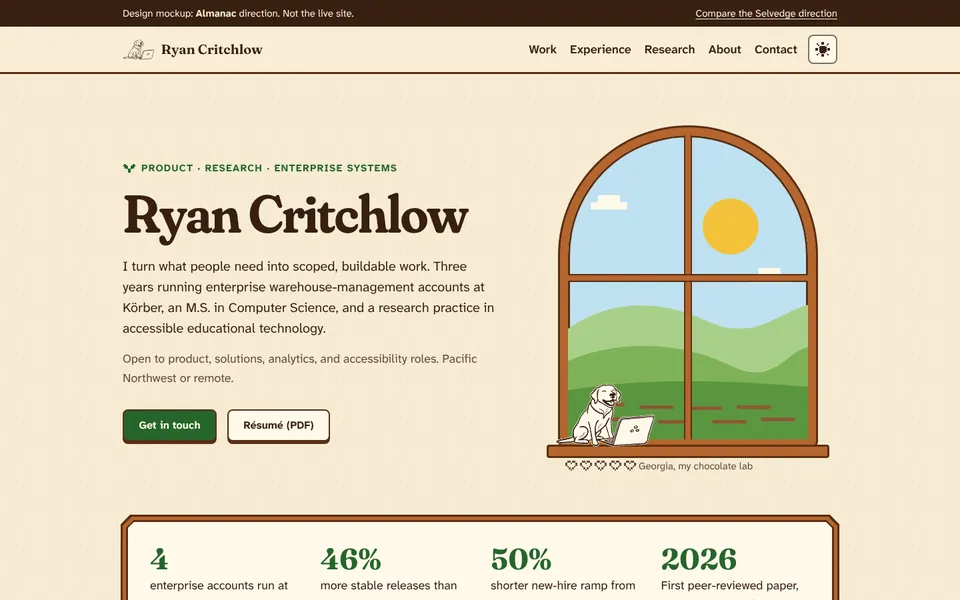
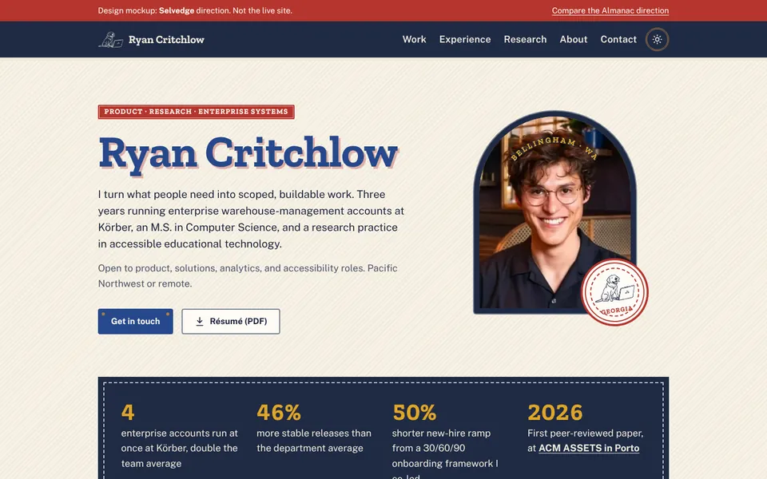

# Design review: ryancritchlow.com, October 2026

Goal: a site that is fun to use and stands out, while staying clean, fast and fully accessible. It should follow 2026 practice and the official docs.

Five agents did the groundwork: three literature reviews, an audit of the current site, and a cross-reference of the audit against the literature. I built four mockups, wrote the accessibility checker, and ran it on the current site and every mockup.

## Before ASSETS (October 25–28)

People at an accessibility conference will open the live site, and some will tab through it or turn on reduced motion. Today it fails six checks they're likely to notice. In order:

1. **Fix Phase 0 on the live site** ([below](#phase-0-try-it-yourself-first)). The skip link, focus rings, High Contrast, reduced motion and the blank page without JavaScript are each a few lines.
2. **Lazy-load the bartending photos, or cut the marquee.** They're 2.47 MB, which is slow on conference Wi-Fi and phone data.
3. **Add an `/assets` page** with the paper, the ACM Digital Library link, accessible slides and a way to reach you. Put its QR code and short URL on your final slide.
4. **Fill the paper's placeholders:** session time, ACM Digital Library link, slides link.
5. **The redesign is optional before the conference.** Phase 0 matters more.

## What's in this folder

| File                                                                           | What it is                                                                                                                                                                                                                      |
| ------------------------------------------------------------------------------ | ------------------------------------------------------------------------------------------------------------------------------------------------------------------------------------------------------------------------------- |
| [01a-literature-motion-platform.md](01a-literature-motion-platform.md)         | Animation and interaction: Svelte 5 / SvelteKit docs, 2026 CSS platform status, motion accessibility, performance, what "delight" means without the gimmicks. Ends with motion tokens.                                          |
| [01b-literature-color-aesthetics.md](01b-literature-color-aesthetics.md)       | Arches and curvature (what the evidence supports), first impressions, color practice (OKLCH, WCAG 2.2 vs APCA), Stardew / workwear / earth palettes, type, texture.                                                             |
| [01c-literature-general-preferences.md](01c-literature-general-preferences.md) | What people _generally_ prefer and what performs, independent of your tastes: color preference studies, light vs dark, layout conventions, how hiring managers read portfolios, type. Ends with an evidence-based design brief. |
| [02-current-site-audit.md](02-current-site-audit.md)                           | An inventory of everything the site uses today, with file:line references, ranked problems and removal candidates.                                                                                                              |
| [03-cross-reference.md](03-cross-reference.md)                                 | The audit checked against the literature: a gap matrix, judgment calls, proposals, a phased roadmap, and a token block for the real site.                                                                                       |
| [04-accessibility-results.md](04-accessibility-results.md)                     | Results from the accessibility checks on the current site and all four mockups.                                                                                                                                                 |
| [mockups/](mockups/)                                                           | Four complete single-page mockups using real content.                                                                                                                                                                           |
| [a11y/](a11y/)                                                                 | The checker (`check.mjs`), the palette contrast tool, and `palettes.json` (205 color pairs, all passing).                                                                                                                       |

## The four mockups

All four share one structure: a 5-link nav, proof in the first screen, then the same five sections. Consensus, Almanac and Selvedge run Work → Experience → Research → About → Contact. Hybrid moves Research to the front for ASSETS. Every mockup is tested in light and dark mode at phone and desktop widths, and every one passes every check.

|            | **Hybrid** (my pick)                                                                                                                 | **Consensus**                                  | **Almanac**                                     | **Selvedge**                                          |
| ---------- | ------------------------------------------------------------------------------------------------------------------------------------ | ---------------------------------------------- | ----------------------------------------------- | ----------------------------------------------------- |
| Built from | Consensus structure plus the fun pieces from the other two                                                                           | Research on what people generally prefer (01c) | Your taste: Stardew Valley, earth tones         | Your taste: Americana workwear                        |
| Look       | Warm off-white, near-black text, one blue; color lives in the illustrations                                                          | White, near-black text, one saturated blue     | Parchment, walnut wood frames, fern green, plum | Raw canvas, indigo, selvedge red, brass               |
| Type       | Fraunces headings, Inter text                                                                                                        | Inter                                          | Fraunces + Atkinson Hyperlegible Next           | Zilla Slab + Public Sans                              |
| Fun        | Day/night window, pet Georgia, a conveyor belt that delivers your four proof points, pixel item icons, a sun that crosses the header | Almost none, on purpose                        | Day/night window, pet Georgia, header sun       | Woven labels, stitched seams, Georgia patch, postcard |

**Hybrid**, desktop and phone:



<p>



</p>



<p>


</p>

### Why Hybrid

The research (01c) gives a clear default: white, near-black and one blue, one familiar sans, a conventional layout, quiet motion. That's Consensus, and it's correct. It's also forgettable, which the same research predicts: familiar layouts win the first glance, and distinctiveness has to come from craft and content.

Hybrid keeps everything that makes the page easy to read, and adds back the parts that make it yours:

- **Kept from the research:**
  - the standard header, with the résumé one click away
  - your role, face and proof in the first screen
  - one Problem / Role / Result template for every project
  - a résumé-style timeline
  - 18 px text and a mostly neutral background with one blue.
- **Added back:** small, colorful illustrations. The window, Georgia, the shipping boxes and the pixel icons carry the warmth. People like a small figure _more_ when its hue contrasts with the background around it (Schloss & Palmer 2011, in 01c §1). So the warm colors work best in small doses against a neutral page, rather than as the page itself.
- **The conveyor belt,** done accessibly:
  - It runs once, in 1.6 seconds, when it scrolls into view, then stops.
  - The visitor can run it again with a button.
  - With reduced motion on, the boxes simply sit on the belt.
  - The four proof points are real text in a list, so screen readers and search engines read them like any other content.

**What the research says about your tastes** (01c, last section): brown and olive are the _least_-liked colors in the main preference studies. The evidence for arches is real but modest, and it was measured on shapes, not page layouts. Neither is a reason to drop them. They are taste rather than evidence, so Hybrid keeps them to small decorative moments.

### Who Hybrid is tuned for

The first people to see this site will be faculty, PhD students and industry researchers at ASSETS 2026 (Porto, October 25–28). After that, it's Salesforce and other support hiring teams. So Hybrid now leads with research and keeps a clear second path for support:

- **Hero:** "At ASSETS 2026 in Porto, October 25–28" in the status line, then "Accessibility and UX research · Enterprise technical support". Two links sit under the buttons: _At ASSETS? Start with the paper_ and _Hiring for support? See how I troubleshoot_.
- **Proof boxes:** the ASSETS paper arrives first, then 4 enterprise accounts, 46% more stable releases, and 2 go-lives as on-site technical lead.
- **Research comes first.** It has a research-interests sentence, the methods you've used, and the ASSETS paper as a featured card: a plain-language summary, your contribution, and slots for the session time, the ACM Digital Library link and accessible slides. Fill those three placeholders before October 25.
- **Work keeps the support case study.** _Enterprise WMS support at Körber_ covers fault isolation across the WMS, order system, Dynamics 365 and network, escalation with evidence, and deadlocks resolved. Salesforce TSE postings ask for exactly this: 2+ years of technical support, SQL, debugging and log reading, and explaining technical issues to non-technical people.
- **Footer:** a one-line accessibility statement. At an accessibility conference, people will check. A site that passes is evidence in itself, and one that fails costs you more there than anywhere else.

Steps that live outside the website:

1. **Get the Salesforce Certified Administrator credential** (Trailhead is free). TSE postings list it as preferred, along with familiarity with Sales Cloud or Service Cloud.
2. **Look at Salesforce's Accessibility Support Team and Office of Accessibility.** That's where support meets accessibility, a natural bridge from a TSE role toward research. Salesforce also runs accessibility user research with Fable.
3. **Restore the _You and I_ case study** before you contact any research team or PhD advisor. It's your strongest research evidence.
4. **Keep an academic CV and a Google Scholar profile** ready for the PhD path; link them from the Research section when they exist.

Sources for the Salesforce points: TSE listings reposted on [purpose.jobs](https://www.purpose.jobs/discover/companies/salesforce-2/jobs/90254713-technical-support-engineer) and [jobs.accel.com](https://jobs.accel.com/companies/airkit-2/jobs/84486793-technical-support-engineer-sales-cloud) (check the official posting before applying); [Salesforce Accessibility Support Team](https://catherwood.library.cornell.edu/wit/salesforce-introduces-new-product-accessibility-support-team/); [Fable on Salesforce's accessibility research](https://makeitfable.com/article/how-salesforce-shapes-ai-ux-design/).

## What the review found about the current site

- **The foundation is good.** It's a prerendered static site with clean Svelte 5 code, a semantic token layer with contrast notes, and real accessibility basics. Keep all of that.
- **Lighthouse gives accessibility 100, but the deeper checks found 6 real failures.** They are:
  - the skip link's contrast
  - the focus-ring contrast
  - 12 controls with no focus ring in Windows High Contrast
  - two animations that keep moving with reduced motion on (the photo marquee and the conveyor belt; Level A)
  - a scroll box that keyboard users can't reach in Safari and Firefox.
- **Visitors without JavaScript see a blank page.** Every card and every contact link starts invisible in CSS.
- **90% of the page weight is ten bartending photos** (2.47 MB, all loaded up front). Lazy-loading them alone takes Lighthouse LCP from 8.9 s to 2.7 s.
- **The best proof sits about 4,300 px down.** A hiring manager scanning the first screen sees a name and a paragraph.
- **The WMS simulator is your best product thinking, and also 55% of the code.** It ships to every visitor, has focus and contrast failures, and has a state bug.

## Proposals

Details are in [03 §4](03-cross-reference.md#4-proposals-to-the-owner) and [01c's design brief](01c-literature-general-preferences.md#evidence-based-default-design-brief).

**Edit**

1. Put role, face and proof in the first screen.
2. Restore the archived _You and I_ case study at `/work/you-and-i`. It's your strongest research piece and it's hidden.
3. Adopt the Hybrid palette and type: a warm off-white background, one blue, Fraunces headings and Inter text. Inter is already self-hosted, so this adds one font.
4. Keep arches, wood and warm colors to illustrations and small moments.
5. Rewrite Experience in reverse-chronological order, three bullets each, with the rest behind "more from this role".
6. Fix the content errors: the Power BI and Tableau logos are Azure and Firebase, "WCAG 2.1" should be 2.2, and "Atlas Woodworks" vs "Atlas Northwest" don't match.

**Simplify**

1. Cut the nav from 8 links to 5: Work, Experience, Research, About, Contact. Add a Résumé button.
2. Move the simulator to its own `/simulator` page, linked once, with no modal.
3. Drop scroll-triggered text animation. Motion happens only when the visitor does something, or once, like the conveyor.
4. Use one container width, so every section shares one left edge.

**Rework or remove**

1. **Conveyor belt: rework it** the way Hybrid does (it runs once, has a replay button, and stays still under reduced motion), and make it carry the proof points.
2. **Remove** the bartending photo marquee and lightbox. Keep one photo in About.
3. **Remove** the drifting background layer, the CDN tool logos, the unused typography plugin and JetBrains Mono.
4. **Remove** your phone number from the public page. Email plus LinkedIn is enough, and it cuts spam.
5. **Remove** the dead files: the old headshot, the root résumé, the duplicate `CNAME` and the unused case-study image.

## Decisions I need from you

1. **Direction:** Hybrid (my pick), Consensus, Almanac, or Selvedge? You can also mix and match pieces.
2. **Positioning line:** Hybrid now uses "Accessibility and UX research · Enterprise technical support" for ASSETS. After the conference you could flip the order for support applications. Does that read right to you?
3. **Before ASSETS:** ship Phase 0 to the live site (strongly recommended), and decide whether the redesign also goes live before October 25.
4. **Simulator:** move it to its own page (recommended), or cut it?
5. **Photos:** can you send a headshot that's 800 px or larger? The current one is 325 px and looks soft on phones.

## Phase 0: try it yourself first

These are small, self-contained fixes and good practice in Svelte and CSS. Each one has a hint here; the full answer is in [03 §5](03-cross-reference.md#5-phased-roadmap) and [03 §6](03-cross-reference.md#6-proposed-design-tokens-almanac-01b-palette-b-tuned). For the conveyor belt, the answer is in `mockups/hybrid.html`.

1. **Skip link contrast** (`SkipLink.svelte`). White on `accent-500` is 3.12:1. _Hint:_ which stop on the accent ramp gets white text past 4.5:1? Check it with `node docs/design-review/a11y/palette-contrast.mjs`.
2. **Focus rings in High Contrast** (`Simulator.svelte:73`, `Experience.svelte:219,264,277`). _Hint:_ what does Windows High Contrast do to `box-shadow`? What happens if you delete `focus:outline-none` and let the global `:focus-visible` rule apply?
3. **Blank page without JS** (`app.css:318-329`). _Hint:_ make the hidden state depend on a class that only JavaScript adds.
4. **Conveyor belt** (`ConveyorBelt.svelte`). _Hints:_
   - Replace `infinite` with a play count, or make it play once when it scrolls into view.
   - In the `prefers-reduced-motion: reduce` block, set `animation: none` instead of slowing it down.
   - A "Run it again" `<button>` can remove and re-add the class that starts the animation.
5. **Photo weight** (`Experience.svelte`). _Hint:_ two attributes on ``, plus `width` and `height`.
6. **Theme flash** (`app.html`). _Hint:_ what does the inline script do when the saved value is `"system"`?

Then re-run the checker (below) and watch the failures drop to zero.

## Re-running the accessibility checks

```sh
npm run build
npx serve build -l 4173 -s &          # or: npm run preview
cd docs/design-review/a11y
npm install                            # Playwright, axe-core, Lighthouse (Chromium must be installed)
node check.mjs http://localhost:4173/  # add more URLs to check several pages
node palette-contrast.mjs palettes.json
```

`check.mjs` exits with code 1 when it finds a failure, so it can become a CI gate (03 §5, PR 0.7).
