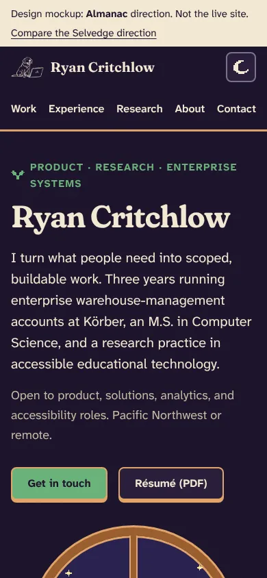
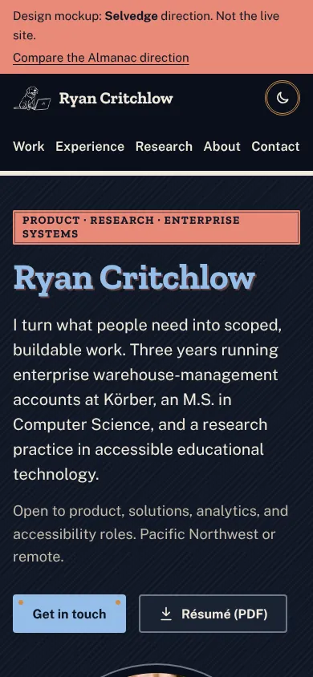

# Design review: ryancritchlow.com, October 2026

Goal: a site that is fun to use and stands out, while staying clean, fast and fully accessible. It should follow 2026 practice and the official docs, and draw on vintage Americana workwear, Stardew Valley, earth tones and arches.

Four agents did the groundwork: two literature reviews, an audit of the current site, and a cross-reference of the two. I built two mockups, wrote the accessibility checker, and ran it on the current site and both mockups.

## What's in this folder

| File                                                                     | What it is                                                                                                                                                                                                     |
| ------------------------------------------------------------------------ | -------------------------------------------------------------------------------------------------------------------------------------------------------------------------------------------------------------- |
| [01a-literature-motion-platform.md](01a-literature-motion-platform.md)   | Animation and interaction: Svelte 5 / SvelteKit docs, 2026 CSS platform status, motion accessibility, performance, what "delight" means without the gimmicks. Ends with motion tokens.                         |
| [01b-literature-color-aesthetics.md](01b-literature-color-aesthetics.md) | Arches and curvature (what the evidence supports), first impressions, color practice (OKLCH, WCAG 2.2 vs APCA), Stardew / workwear / earth palettes, type, texture. Ends with three contrast-checked palettes. |
| [02-current-site-audit.md](02-current-site-audit.md)                     | An inventory of everything the site uses today, with file:line references, ranked problems and removal candidates.                                                                                             |
| [03-cross-reference.md](03-cross-reference.md)                           | The audit checked against the literature: a gap matrix, judgment calls, proposals, a phased roadmap, and a ready-to-paste token block for the real site.                                                       |
| [04-accessibility-results.md](04-accessibility-results.md)               | Results from the accessibility checks on the current site and both mockups.                                                                                                                                    |
| [mockups/](mockups/)                                                     | Two complete single-page mockups using real content. Open them in a browser and try the theme toggle and Georgia.                                                                                              |
| [a11y/](a11y/)                                                           | The checker (`check.mjs`), the palette contrast tool, and `palettes.json`.                                                                                                                                     |

## The two mockups

Both use the same simplified structure (5-link nav, proof up front, Work → Experience → Research → About → Contact). Both are tested in light and dark mode at phone and desktop widths. Neither hides content behind animation.

|              | **Almanac** (Stardew-leaning)                                                                                                               | **Selvedge** (Americana-leaning)                                                                                                                              |
| ------------ | ------------------------------------------------------------------------------------------------------------------------------------------- | ------------------------------------------------------------------------------------------------------------------------------------------------------------- |
| Look         | Parchment, walnut wood frames, fern green, plum links                                                                                       | Raw canvas, indigo denim, selvedge red, brass rivets                                                                                                          |
| Arch moments | An arched farmhouse window looking out on the valley; arched portrait in About                                                              | An arched shop window with gold-leaf sign lettering; arched photo in About                                                                                    |
| Type         | Fraunces (soft axis) + Atkinson Hyperlegible Next                                                                                           | Zilla Slab + Public Sans (the U.S. Web Design System face)                                                                                                    |
| The fun part | Day/night valley that follows the theme. Pet Georgia to fill Stardew-style friendship hearts. A pixel sun crosses the header as you scroll. | Woven labels, stitched seams, rubber-stamp research status. Pat the Georgia patch. A seam gets sewn across the header as you scroll. A postcard to say hello. |
| Theme switch | A circle of day or night opens from the button                                                                                              | A roller shade pulls down                                                                                                                                     |


<p>


</p>

**My recommendation is Almanac**, with two Selvedge details borrowed: stitched rules and woven-label tags. It keeps the identity the current site already has, it's the most Stardew of the options, and the cross-reference's token block (03 §6) is built for it.

## What the review found

- **The foundation is good.** It's a prerendered static site with clean Svelte 5 code, a semantic token layer with contrast notes, and real accessibility basics. Keep all of that.
- **Lighthouse gives accessibility 100, but the deeper checks found 6 real failures.** They are:
  - the skip link's contrast
  - the focus-ring contrast
  - 12 controls with no focus ring in Windows High Contrast
  - two animations that keep moving with reduced motion on (the photo marquee and the conveyor belt; Level A)
  - a scroll box that keyboard users can't reach in Safari and Firefox.
- **Visitors without JavaScript see a blank page.** Every card and every contact link starts invisible in CSS.
- **90% of the page weight is ten bartending photos** (2.47 MB, all loaded up front). That one change explains the poor Lighthouse performance score: lazy-loading them alone takes LCP from 8.9 s to 2.7 s.
- **The best proof sits about 4,300 px down.** That's the ASSETS paper and the Körber numbers. A hiring manager scanning the first screen sees a name and a paragraph.
- **The WMS simulator is your best product thinking, and also 55% of the code.** It ships to every visitor, has focus and contrast failures, and has a state bug.

## Proposals

Each item is detailed in [03 §4](03-cross-reference.md#4-proposals-to-the-owner).

**Edit**

1. Put role and proof in the first screen: a short positioning line plus four proof points (see the mockups).
2. Restore the archived _You and I_ case study at `/work/you-and-i`. It's your strongest research piece and it's hidden.
3. Adopt the Almanac palette, Fraunces soft and Atkinson Hyperlegible Next. All 76 token pairs pass WCAG 2.2 AA.
4. Use arches only for framing moments, at most 3 per page. Cards stay rectangular.
5. Rewrite Experience in reverse-chronological order, three bullets each, with the rest behind "more from this role".
6. Fix the content errors: the Power BI and Tableau logos are Azure and Firebase, "WCAG 2.1" should be 2.2, and "Atlas Woodworks" vs "Atlas Northwest" don't match.

**Simplify**

1. Cut the nav from 8 links to 5: Work, Experience, Research, About, Contact. Skills and Education fold into one "Toolbox" block.
2. Move the simulator to its own `/simulator` page, linked once, with no modal.
3. Animate card groups only: 250 ms, 8–12 px, played once. Never animate the hero or body text.
4. Use one container width, so every section shares one left edge.

**Remove**

1. The bartending photo marquee and lightbox. Keep one photo in About at most.
2. The conveyor belt and the drifting background layer.
3. The CDN tool logos, the unused typography plugin and JetBrains Mono (40 KB for a few labels).
4. Your phone number from the public page. The mockups leave it out; email plus LinkedIn is enough, and it cuts spam.
5. Dead files: the old headshot, the root résumé, the duplicate `CNAME` and the unused case-study image.

## Decisions I need from you

1. **Direction:** Almanac, Selvedge, or Almanac with Selvedge details (my pick)?
2. **Positioning line:** keep "Product · Research · Enterprise Systems", or try 03's "Product & business analyst · HCI and accessibility research"?
3. **Simulator:** move it to its own page (recommended), or cut it?
4. **Photos:** can you send a higher-resolution headshot (800 px or larger)? The current one is 325 px and looks soft on phones.

## Phase 0: try it yourself first

These are small, self-contained fixes and good practice in Svelte and CSS. Each one has a hint here; the full answer is in [03 §5](03-cross-reference.md#5-phased-roadmap) and [03 §6](03-cross-reference.md#6-proposed-design-tokens-almanac-01b-palette-b-tuned).

1. **Skip link contrast** (`SkipLink.svelte`). White on `accent-500` is 3.12:1. _Hint:_ which stop on the accent ramp gets white text past 4.5:1? Check it with `node docs/design-review/a11y/palette-contrast.mjs`.
2. **Focus rings in High Contrast** (`Simulator.svelte:73`, `Experience.svelte:219,264,277`). _Hint:_ what does Windows High Contrast do to `box-shadow`? What happens if you delete `focus:outline-none` and let the global `:focus-visible` rule apply?
3. **Blank page without JS** (`app.css:318-329`). _Hint:_ make the hidden state depend on a class that only JavaScript adds.
4. **Reduced motion** (`ConveyorBelt.svelte`, the marquee in `Experience.svelte`). _Hint:_ WCAG 2.2.2 says a loop longer than 5 seconds needs a pause control, and slowing it down doesn't count. Removing it is the simplest fix.
5. **Photo weight** (`Experience.svelte`). _Hint:_ two attributes on ``, plus `width` and `height`.
6. **Theme flash** (`app.html`). _Hint:_ what does the inline script do when the saved value is `"system"`?

Then re-run the checker (below) and watch the failures drop to zero.

## Re-running the accessibility checks

```sh
npm run build
npx serve build -l 4173 -s &          # or: npm run preview
cd docs/design-review/a11y
npm install                            # Playwright, axe-core, Lighthouse (Chromium must be installed)
node check.mjs http://localhost:4173/  # add more URLs to check several pages
node palette-contrast.mjs palettes.json
```

`check.mjs` exits with code 1 when it finds a failure, so it can become a CI gate (03 §5, PR 0.7).
