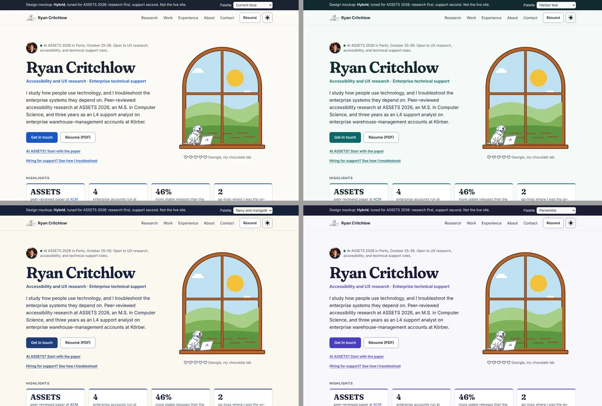
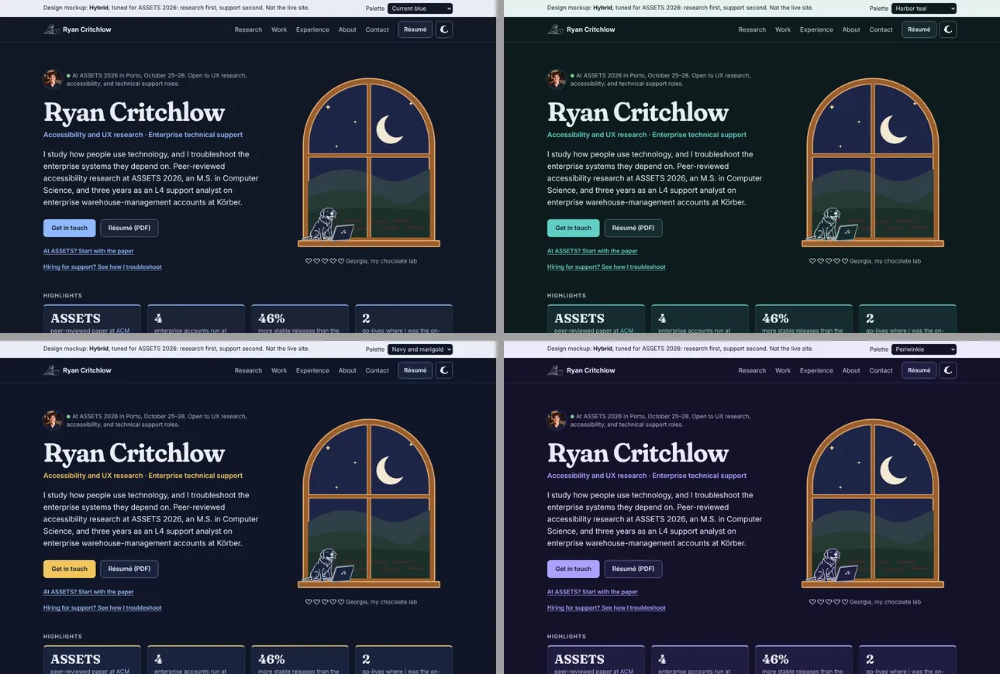

# Design review: ryancritchlow.com, October 2026

Goal: a site that is fun to use and stands out, while staying clean, fast and fully accessible. It should follow 2026 practice and the official docs.

Five agents did the groundwork: three literature reviews, an audit of the current site, and a cross-reference of the audit against the literature. I wrote the accessibility checker, fixed the live site's failures (Phase 0), and kept one mockup, Hybrid, with four research-backed palettes to compare.

## Status

**Phase 0 is live on `main`** (commit `4ca3ebc`, October 14). The real site passes every check in [04](04-accessibility-results.md), and the bartending photos are replaced by hand-drawn scenes. It was ported on top of PR #3 from another session: that PR's hero stats row, self-hosted icons, 404 page and link preview stay; its bartending photo slider and lightbox were replaced by the drawing. See [Phase 0: what changed](#phase-0-what-changed).

**Hybrid is the one mockup.** Consensus, Almanac and Selvedge are retired; they're in this branch's git history if you ever want a piece back.

## Before ASSETS (October 25–28)

People at an accessibility conference will open the live site, and some will tab through it or turn on reduced motion. In order:

1. **Phase 0 is live.** Done October 14.
2. **Add an `/assets` page** with the paper, the ACM Digital Library link, accessible slides and a way to reach you. Put its QR code and short URL on your final slide.
3. **Fill the paper's placeholders** in Hybrid: session time, ACM Digital Library link, slides link.
4. **The redesign is optional before the conference.** Phase 0 matters more.

## What's in this folder

| File                                                                           | What it is                                                                                                                                                                                                                      |
| ------------------------------------------------------------------------------ | ------------------------------------------------------------------------------------------------------------------------------------------------------------------------------------------------------------------------------- |
| [01a-literature-motion-platform.md](01a-literature-motion-platform.md)         | Animation and interaction: Svelte 5 / SvelteKit docs, 2026 CSS platform status, motion accessibility, performance, what "delight" means without the gimmicks. Ends with motion tokens.                                          |
| [01b-literature-color-aesthetics.md](01b-literature-color-aesthetics.md)       | Arches and curvature (what the evidence supports), first impressions, color practice (OKLCH, WCAG 2.2 vs APCA), Stardew / workwear / earth palettes, type, texture.                                                             |
| [01c-literature-general-preferences.md](01c-literature-general-preferences.md) | What people _generally_ prefer and what performs, independent of your tastes: color preference studies, light vs dark, layout conventions, how hiring managers read portfolios, type. Ends with an evidence-based design brief. |
| [02-current-site-audit.md](02-current-site-audit.md)                           | An inventory of everything the site used before Phase 0, with file:line references, ranked problems and removal candidates.                                                                                                     |
| [03-cross-reference.md](03-cross-reference.md)                                 | The audit checked against the literature: a gap matrix, judgment calls, proposals, a phased roadmap, and a token block for the real site.                                                                                       |
| [04-accessibility-results.md](04-accessibility-results.md)                     | Accessibility results for the site before and after Phase 0, and for Hybrid in all four palettes.                                                                                                                               |
| [mockups/hybrid.html](mockups/hybrid.html)                                     | The Hybrid mockup, using real content. It opens in Navy and marigold; the banner's picker switches palettes, and `hybrid.html?palette=blue` (or `harbor`, `periwinkle`) opens one directly.                                     |
| [illustrations/](illustrations/)                                               | The script that draws the job-card scenes (bar, circular saw, workbench).                                                                                                                                                       |
| [a11y/](a11y/)                                                                 | The checker (`check.mjs`), the palette contrast tool, and `palettes.json` (every color pair, all passing).                                                                                                                      |

## Hybrid


<p>


</p>

### Why Hybrid

The research (01c) gives a clear default: a light neutral page, near-black text, one blue, one familiar sans, a conventional layout and quiet motion. It's correct, and on its own it's forgettable. The same research predicts that: familiar layouts win the first glance, and distinctiveness has to come from craft and content.

Hybrid keeps everything that makes the page easy to read, and adds back the parts that make it yours:

- **Kept from the research:**
  - the standard header, with the résumé one click away
  - your role, face and proof in the first screen
  - one Problem / Role / Result template for every project
  - a résumé-style timeline
  - 18 px text and a mostly neutral background with one hue family.
- **Added back:** small, colorful illustrations: the day/night window, Georgia to pet, pixel item icons, and hand-drawn scenes on the woodworking, bartending and construction roles. People like a small figure _more_ when its hue contrasts with the background around it (Schloss & Palmer 2011, in 01c §1). So the warm colors work best in small doses against a neutral page, rather than as the page itself.
- **The conveyor belt lives only on the Körber card.** It runs once when it scrolls into view, can be replayed, and stays still with reduced motion on. The first screen no longer has shipping boxes, so the page doesn't pitch you as a warehouse professional.

**What the research says about your tastes** (01c, last section): brown and olive are the _least_-liked colors in the main preference studies. The evidence for arches is real but modest, and it was measured on shapes, not page layouts. Neither is a reason to drop them. They are taste rather than evidence, so Hybrid keeps them to small decorative moments.

### Palette options

Each option keeps the same layout and illustrations and swaps the hue family. All four pass WCAG 2.2 AA in light and dark mode (every pair is in [a11y/palettes.json](a11y/palettes.json), and all four were run through `check.mjs`). They all stay in the blue family on purpose: it's the one result every preference study agrees on.

| Palette               | Light                                      | Dark                                  | Why it's backed by research                                                                                                                                                                                                                                                            |
| --------------------- | ------------------------------------------ | ------------------------------------- | -------------------------------------------------------------------------------------------------------------------------------------------------------------------------------------------------------------------------------------------------------------------------------------- |
| **Original blue**     | Warm off-white, near-black, `#1a56c4`      | Deep navy, light blue `#8fb8ff`       | Saturated blue is the peak of the preference curve (Palmer & Schloss 2010) and the favorite in every country polled (01c §1).                                                                                                                                                          |
| **Harbor teal**       | Mint-white, deep teal ink, teal `#0c6668`  | Deep sea, aqua `#62cfc3`              | Blue-green is among the most pleasant hues (Valdez & Mehrabian 1994), and preference tracks the objects a color brings to mind, like water and evergreens (Palmer & Schloss 2010). It's also Bellingham. Pale coral tags are the small contrasting figure.                             |
| **Navy and marigold** | Warm paper, navy `#1f3d7a`, pale gold tags | Navy page, marigold buttons `#f2c55c` | The same liked hue at a deeper, more formal value. Blue is associated with competence in brand research (Labrecque & Milne 2012; an association, not a hiring effect, 01b). Marigold nods to your Americana taste and stays a small accent, so the page never turns brown.             |
| **Periwinkle**        | Lavender-white, indigo-violet `#4a3dc2`    | Night violet, periwinkle `#aaa2ff`    | Purple-blue is also among the most pleasant hues (Valdez & Mehrabian 1994), and both sexes prefer bluish hues, with women shifting toward purple (Hurlbert & Ling 2007). Few portfolios use it, so it's the most distinctive of the four. Pale gold tags are the complementary figure. |





**Your pick (October 14): Navy and marigold.** Hybrid now opens in it. It's the right fit for the audience: the most-liked hue at a formal value, with marigold as the personal accent.

Valdez, P., & Mehrabian, A. (1994). Effects of color on emotions. _Journal of Experimental Psychology: General, 123_(4), 394–409. https://doi.org/10.1037/0096-3445.123.4.394. The other studies are cited in 01b and 01c.

### Who Hybrid is tuned for

The first people to see this site will be faculty, PhD students and industry researchers at ASSETS 2026 (Porto, October 25–28). After that, it's Salesforce and other support hiring teams. So Hybrid leads with research and keeps a clear second path for support:

- **Hero:** "At ASSETS 2026 in Porto, October 25–28" in the status line, then "Accessibility and UX research · Enterprise technical support". Two links sit under the buttons: _At ASSETS? Start with the paper_ and _Hiring for support? See how I troubleshoot_.
- **Highlights:** the ASSETS paper, 4 enterprise accounts, 46% more stable releases, and 2 go-lives as on-site technical lead. They cover your two strongest roles; if you'd rather say something else up there, it's four list items to change.
- **Research comes first.** It has a research-interests sentence, the methods you've used, and the ASSETS paper as a featured card: a plain-language summary, your contribution, and slots for the session time, the ACM Digital Library link and accessible slides.
- **Work keeps the support case study.** _Enterprise WMS support at Körber_ covers fault isolation across the WMS, order system, Dynamics 365 and network, escalation with evidence, and deadlocks resolved. Salesforce TSE postings ask for exactly this: 2+ years of technical support, SQL, debugging and log reading, and explaining technical issues to non-technical people.
- **Footer:** a one-line accessibility statement. At an accessibility conference, people will check. A site that passes is evidence in itself, and one that fails costs you more there than anywhere else.

Steps that live outside the website:

1. **Get the Salesforce Certified Administrator credential** (Trailhead is free). TSE postings list it as preferred, along with familiarity with Sales Cloud or Service Cloud.
2. **Look at Salesforce's Accessibility Support Team and Office of Accessibility.** That's where support meets accessibility, a natural bridge from a TSE role toward research. Salesforce also runs accessibility user research with Fable.
3. **Restore the _You and I_ case study** before you contact any research team or PhD advisor. It's your strongest research evidence.
4. **Keep an academic CV and a Google Scholar profile** ready for the PhD path; link them from the Research section when they exist.

Sources for the Salesforce points: TSE listings reposted on [purpose.jobs](https://www.purpose.jobs/discover/companies/salesforce-2/jobs/90254713-technical-support-engineer) and [jobs.accel.com](https://jobs.accel.com/companies/airkit-2/jobs/84486793-technical-support-engineer-sales-cloud) (check the official posting before applying); [Salesforce Accessibility Support Team](https://catherwood.library.cornell.edu/wit/salesforce-introduces-new-product-accessibility-support-team/); [Fable on Salesforce's accessibility research](https://makeitfable.com/article/how-salesforce-shapes-ai-ux-design/).

## What the review found about the site

- **The foundation is good.** It's a prerendered static site with clean Svelte 5 code, a semantic token layer with contrast notes, and real accessibility basics. Keep all of that.
- **Lighthouse gave accessibility 100, but the deeper checks found 6 real failures.** All six are fixed on this branch (see below).
- **Visitors without JavaScript saw a blank page.** Fixed.
- **90% of the page weight was ten bartending photos** (2.47 MB). Removed; the drawings that replace them are about 12 KB each and load lazily.
- **The best proof sits about 4,300 px down.** A hiring manager scanning the first screen sees a name and a paragraph. Hybrid shows the fix.
- **The WMS simulator is your best product thinking, and also 55% of the code.** It ships to every visitor and has a state bug.

## Proposals

Details are in [03 §4](03-cross-reference.md#4-proposals-to-the-owner) and [01c's design brief](01c-literature-general-preferences.md#evidence-based-default-design-brief).

**Edit**

1. Put role, face and proof in the first screen.
2. Restore the archived _You and I_ case study at `/work/you-and-i`. It's your strongest research piece and it's hidden.
3. Adopt Hybrid's layout, type (Fraunces headings, Inter text) and whichever palette you pick.
4. Keep arches, wood and warm colors to illustrations and small moments.
5. Rewrite Experience in reverse-chronological order, three bullets each, with the rest behind "more from this role".
6. Fix the content errors: the Power BI and Tableau logos are Azure and Firebase, "WCAG 2.1" should be 2.2, and "Atlas Woodworks" vs "Atlas Northwest" don't match.

**Simplify**

1. Cut the nav from 8 links to 5: Research, Work, Experience, About, Contact. Add a Résumé button.
2. Move the simulator to its own `/simulator` page, linked once, with no modal.
3. Drop scroll-triggered text animation. Motion happens only when the visitor does something, or once, like the conveyor.
4. Use one container width, so every section shares one left edge.

**Remove**

1. **Remove** the drifting background layer, the CDN tool logos, the unused typography plugin and JetBrains Mono.
2. **Remove** your phone number from the public page. Email plus LinkedIn is enough, and it cuts spam.
3. **Remove** the dead files: the old headshot, the root résumé, the duplicate `CNAME` and the unused case-study image.

## Decisions I need from you

1. **Highlights:** keep the four numbers, or change what the first screen says? The live site now has the same kind of stats row (from PR #3), so the decision covers both.
2. **Positioning line:** "Accessibility and UX research · Enterprise technical support" for ASSETS. After the conference you could flip the order for support applications.
3. **Simulator:** move it to its own page (recommended), or cut it?
4. **Photos:** can you send a headshot that's 800 px or larger? The current one is 325 px and looks soft on phones.

## Phase 0: what changed

Each fix is small and worth reading as a Svelte and CSS pattern.

1. **Skip link contrast** (`SkipLink.svelte`). White on `accent-800` is 7.7:1; it was 3.1:1 on `accent-500`.
2. **One focus style** (`app.css`). A `--t-focus` token per theme (`accent-700` light, `accent-300` dark) clears 4:1 on every background. The `focus:outline-none focus:ring-*` classes are gone from `Simulator.svelte`, `Experience.svelte` and `PickingPanel.svelte`. Those rings were box-shadows, which Windows High Contrast removes; outlines survive.
3. **No blank page without JavaScript** (`app.html`, `app.css`). The inline script adds a `js` class, and reveal animations only hide content under `.js`.
4. **Conveyor belt** (`ConveyorBelt.svelte`). It parks its boxes off the belt, delivers them once when it scrolls into view, and offers "Run the belt again". Both the parked state and the run sit inside `prefers-reduced-motion: no-preference`, so with reduced motion the boxes just sit there.
5. **Photos replaced by drawings** (`JobScene.svelte`, `static/illustrations/`). The photo slider, lightbox and all bartending photos are gone. The headshot loads lazily with its dimensions set.
6. **Theme flash** (`app.html`, `theme.svelte.ts`). The inline script now treats a saved `"system"` like no preference, and storage access is wrapped so blocked storage can't break the page.
7. **Scroll box** (`Simulator.svelte`). The workflow diagram's scroll container is focusable, with a region label, so keyboard users can scroll it in Safari and Firefox.
8. **Hero** (`Hero.svelte`). No reveal animation on the first screen, so it's readable at first paint.

## Re-running the accessibility checks

```sh
npm run build
npx serve build -l 4173 -s &          # or: npm run preview
cd docs/design-review/a11y
npm install                            # Playwright, axe-core, Lighthouse (Chromium must be installed)
node check.mjs http://localhost:4173/  # add more URLs to check several pages
node palette-contrast.mjs palettes.json
```

`check.mjs` exits with code 1 when it finds a failure, so it can become a CI gate (03 §5, PR 0.7).
